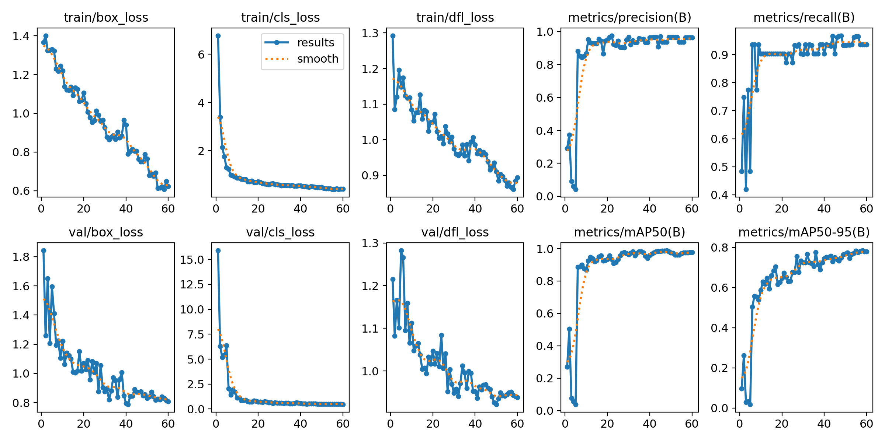
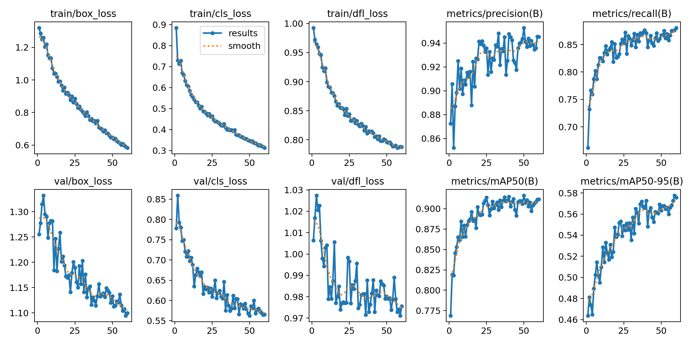
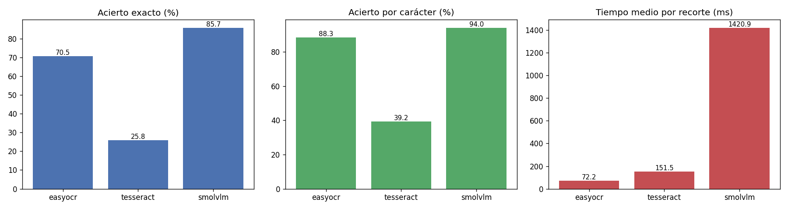
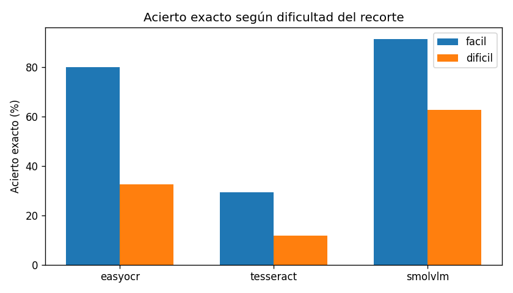

# Práctica 4 · Detección de vehículos, matrículas y OCR

Prototipo que procesa el vídeo de test (`C0142.MP4`) y:

- detecta y sigue personas y vehículos (YOLO11n + ByteTrack, con unión de pistas para corregir cambios de ID),
- detecta sus matrículas con un YOLO11n entrenado por nosotros, también las lejanas,
- lee el texto de las matrículas con un OCR híbrido (EasyOCR en cada fotograma + SmolVLM sobre los mejores recortes de cada vehículo), diseñado a partir de la comparativa de P4b,
- cuenta los objetos únicos de cada clase y su dirección de salida,
- guarda el vídeo anotado, un vídeo anonimizado y los CSV.

### Entregables

| Qué | Dónde |
|---|---|
| Cuaderno del prototipo (seguimiento, OCR, conteo, CSV, flujo, anonimización) | [`P4/seguimiento_y_csv.ipynb`](P4/seguimiento_y_csv.ipynb) |
| Cuaderno del detector de matrículas (entrenamiento y comparación) | [`P4/VC_P4_Yolo.ipynb`](P4/VC_P4_Yolo.ipynb) |
| Cuaderno de la comparativa de OCR (P4b) | [`P4b/VC_P4b_entrega.ipynb`](P4b/VC_P4b_entrega.ipynb) |
| CSV de detecciones y seguimiento | [`P4/resultado_seguimiento/detecciones.csv`](P4/resultado_seguimiento/detecciones.csv) |
| Conteo, matrículas leídas y flujo | [`conteo.csv`](P4/resultado_seguimiento/conteo.csv), [`matriculas_leidas.csv`](P4/resultado_seguimiento/matriculas_leidas.csv), [`flujo.csv`](P4/resultado_seguimiento/flujo.csv) |
| Vídeo resultado y vídeo anonimizado | [Carpeta P4 en Google Drive](https://drive.google.com/drive/folders/15SfuHr97QuRhpA5OweJGkpNzz6gs5Ni2): `seguimiento_h264.mp4` y `seguimiento_anonimo_h264.mp4` |
| Datasets (detector y OCR) | [Misma carpeta de Google Drive](https://drive.google.com/drive/folders/15SfuHr97QuRhpA5OweJGkpNzz6gs5Ni2): `datos_P4_matriculas.zip` (328 MB) |

## Estructura

```
VC_P4/
├── README.md
├── requirements.txt                dependencias del entorno
├── descargar_datos.py              descarga datos/ desde Hugging Face
├── datos/                          (no se sube a GitHub: está en Google Drive)
│   ├── dataset_limpio/             dataset YOLO de matrículas usado para entrenar
│   ├── dataset_lejanas/            matrículas reducidas (data augmentation), se genera con P4/generar_dataset_reducido.py
│   └── matriculas_recortadas/      recortes para el OCR; ocr_dataset.csv (texto real) sí se sube
├── P4/                             detección
│   ├── seguimiento_y_csv.ipynb     ★ prototipo final: seguimiento, matrículas, OCR, conteo, CSV, flujo y anonimización
│   ├── resultado_seguimiento/      salida del prototipo: CSV, recortes de matrícula (y vídeos, que no se suben)
│   ├── resultado_matriculas/       (no se sube) vídeo solo con las matrículas, generado por VC_P4_Yolo.ipynb
│   ├── VC_P4_Yolo.ipynb            ★ detector de matrículas final: entrenamiento, comparación y vídeo de matrículas
│   ├── runs/comparacion_lejanas/   tablas y hojas de contacto de la comparación de modelos
│   ├── entrenar_matriculas.py      entrena y evalúa el detector (local, 640)
│   ├── generar_dataset_reducido.py genera datos/dataset_lejanas a partir de dataset_limpio
│   ├── runs/matriculas_yolo11n/    entrenamiento local a 640: curvas, matriz de confusión, weights/best.pt
│   ├── runs/matriculas_yolo11n_lejanas/  ★ modelo final: entrenamiento con matrículas reducidas
│   ├── runs/matriculas_yolo11n_1280/   entrenamiento a 1280 (Colab, `batch=4`, `scale=0.9`)
│   ├── runs/matriculas_yolo11n_test/   evaluación en test
│   └── yolo11n.pt                  YOLO11n preentrenado en COCO (personas y vehículos)
└── P4b/                            OCR
    ├── VC_P4b_entrega.ipynb        ★ comparativa EasyOCR / Tesseract / SmolVLM
    ├── recortar_matriculas.py      genera datos/matriculas_recortadas a partir de dataset_limpio
    └── resultados_ocr/             predicciones, resumen y gráficas de la comparativa
```

## Entorno

```bash
conda create --name VC_P4 python=3.9.5
conda activate VC_P4
# antes, PyTorch con CUDA según https://pytorch.org/get-started/locally/
pip install -r requirements.txt
python -m ipykernel install --user --name vc_p4 --display-name "Python (VC_P4)"
```

### Trabajar desde otro equipo

```bash
git clone https://github.com/YoelRuso/VC_P4.git
cd VC_P4
# crear el entorno (ver arriba)
```

**Datos:** descargar `datos_P4_matriculas.zip` de la [carpeta de Google Drive](https://drive.google.com/drive/folders/15SfuHr97QuRhpA5OweJGkpNzz6gs5Ni2) y descomprimirlo en `datos/`. Contiene `dataset_limpio`, `dataset_lejanas` (el del modelo final) y `matriculas_recortadas` (OCR), con un `LEEME.txt` que los describe. Las imágenes contienen matrículas legibles: no redistribuir.

Los pesos (`best.pt`) de cada entrenamiento sí se suben a GitHub (pesan unos 5 MB). El vídeo de test `C0142.MP4` va en `datos/videos/`. Los resultados de un entrenamiento hecho en Colab se descomprimen dentro de `P4/`.

Tesseract se instala aparte ([UB-Mannheim](https://github.com/UB-Mannheim/tesseract/wiki)); su ruta está en la variable `TESSERACT` del cuaderno P4b.

Los miembros del grupo también pueden bajar los datos del repositorio privado de Hugging Face [YoelRuso/MatriculasVC](https://huggingface.co/datasets/YoelRuso/MatriculasVC) con `python descargar_datos.py` (tras `hf auth login`), incluido el vídeo de test (`--solo video`). Ese repositorio no incluye `dataset_lejanas`, que se genera con `python P4/generar_dataset_reducido.py`.

**Equipo de pruebas:** Intel Core i5-10400F, 16 GB RAM, NVIDIA GeForce RTX 3050 (8 GB), Windows 11, PyTorch 2.8 + CUDA 12.6, Ultralytics 8.4.

## 1. Detector de matrículas

### Dataset

Imágenes de vehículos con matrícula española, anotadas en Roboflow con una única clase (`License Plate`) y exportadas en formato YOLOv8. Se fusionaron dos exports de Roboflow, se descartaron 9 imágenes en una limpieza manual y se movieron 24 de train a valid/test para equilibrar el reparto (`datos/dataset_limpio/movimientos_reparto.csv`):

| Split | Imágenes |
|---|---|
| train | 151 |
| valid | 28 |
| test | 31 |

Acceso al dataset: `datos_P4_matriculas.zip` en la [carpeta de Google Drive](https://drive.google.com/drive/folders/15SfuHr97QuRhpA5OweJGkpNzz6gs5Ni2) (licencia CC BY 4.0, la de los proyectos de Roboflow de origen).

### Entrenamiento

`python P4/entrenar_matriculas.py`: YOLO11n preentrenado en COCO, 60 épocas, `imgsz=640`, `batch=8`, GPU. Con AMP activado la pérdida se iba a `nan` en la época 5, por eso se entrena con `amp=False`. Tarda unos 5 minutos.



- Las pérdidas de entrenamiento (`box`, `cls`, `dfl`) bajan de forma continua; las de validación bajan con ellas sin repuntar, así que no hay sobreajuste claro.
- `cls_loss` cae muy rápido: con una sola clase, el problema es sobre todo de localización.
- El mAP50 sube a ≈0,95 hacia la época 20 y se queda en ≈0,98 desde la 40. El mAP50-95 sigue mejorando hasta el final (≈0,78): lo que más cuesta es ajustar la caja con precisión.

| Conjunto | Precisión | Recall | mAP50 | mAP50-95 |
|---|---|---|---|---|
| Validación (28 img.) | 0,963 | 0,935 | 0,975 | 0,785 |
| **Test (31 img.)** | 0,935 | 0,969 | **0,961** | **0,778** |

Los conjuntos de validación y test son pequeños, así que estas cifras tienen bastante margen de error: una matrícula más o menos cambia varios puntos. Ninguna imagen de validación o test se usó para entrenar.

### Comparación de entrenamientos

Mejor época por mAP50-95 de cada `results.csv`, siempre sobre validación:

| Entrenamiento | `imgsz` | `batch` | Época | Precisión | Recall | mAP50 | mAP50-95 |
|---|---|---|---|---|---|---|---|
| Local (`matriculas_yolo11n`) | 640 | 8 | 58 | 0,963 | 0,935 | 0,975 | 0,785 |
| Colab (`matriculas_yolo11n_1280`) | 1280 | 4 | 60 | 0,908 | 1,000 | 0,981 | 0,792 |

Las diferencias son pequeñas para un conjunto de 28 imágenes. El problema real aparece en el vídeo: ninguno de los dos detecta las matrículas lejanas.

## 2. Detector de matrículas lejanas (modelo final)

En el dataset, la matrícula más pequeña mide 31 px de ancho a `imgsz=640`. En el vídeo de test, un coche lejano tiene una matrícula de unos 17×4 px, y además `imgsz=1280` reduce el fotograma de 1920 px y la deja en unos 11 px.

El entrenamiento, la comparación y el vídeo final están en el cuaderno [`P4/VC_P4_Yolo.ipynb`](P4/VC_P4_Yolo.ipynb). El dataset se genera aparte, una sola vez, con `python P4/generar_dataset_reducido.py`. Con la configuración por defecto usa los resultados guardados y solo genera el vídeo final (unos 5 minutos); cada paso largo se activa con una opción en la celda de configuración.

**Dataset (`datos/dataset_lejanas`):** 1600 lienzos de 960×960 (1200 train, 200 valid, 200 test), creados solo a partir de `dataset_limpio`, sin usar el vídeo de test y sin mezclar imágenes entre splits. Sobre una imagen de fondo se pegan recortes de coches reducidos, con el borde difuminado, para que la matrícula mida entre 12 y 120 px (mediana de 27 px en train). Se añade desenfoque y compresión JPEG para imitar un coche lejano en vídeo, y alrededor de un 10 % de los lienzos son negativos, sin matrículas etiquetadas.

**Entrenamiento:** parte de los pesos a 1280, 60 épocas, `imgsz=960`, `batch=8`, `amp=False`, `mosaic=0` y `scale=0.25`, para no encoger más las matrículas pequeñas. Se entrena con los lienzos y las imágenes originales. Tarda alrededor de 1 hora. Después se infiere a `imgsz=1920`, que conserva los píxeles del fotograma.



### Resultados en test

| Modelo | Test | `imgsz` | Precisión | Recall | mAP50 | mAP50-95 |
|---|---|---|---|---|---|---|
| 640 | Real (32 matrículas) | 640 | 0,935 | 0,969 | 0,960 | 0,776 |
| 1280 | Real (32 matrículas) | 1280 | 0,958 | 0,969 | 0,982 | 0,782 |
| **Lejanas** | Real (32 matrículas) | 960 | 0,944 | 0,938 | 0,960 | 0,771 |
| 640 | Reducidas (883 matrículas) | 960 | 0,770 | 0,314 | 0,367 | 0,208 |
| 1280 | Reducidas (883 matrículas) | 960 | 0,874 | 0,353 | 0,413 | 0,266 |
| **Lejanas** | Reducidas (883 matrículas) | 960 | 0,937 | 0,849 | 0,904 | 0,580 |

Con matrículas normales rinde prácticamente igual: la diferencia de recall es una sola matrícula. Con matrículas pequeñas mejora mucho, aunque ese test es sintético y puede dar una imagen optimista.

### Resultados en el vídeo de test

`C0142.MP4`, 1 de cada 10 fotogramas (284), con `conf=0.25`. El vídeo no tiene etiquetas: "dentro de un vehículo" significa que la caja cae en un vehículo y tiene forma de matrícula, lo que **no equivale a precisión**.

| Modelo e `imgsz` | Detecciones | Dentro de un vehículo | Fuera o forma rara | Menos de 20 px | 20-30 px |
|---|---|---|---|---|---|
| 640 a 1280 | 56 | 53 | 3 | 0 | 0 |
| 1280 a 1280 | 86 | 84 | 2 | 0 | 1 |
| 1280 a 1920 | 116 | 112 | 4 | 0 | 8 |
| Lejanas a 1280 | 234 | 233 | 1 | 25 | 74 |
| **Lejanas a 1920** | **292** | **268** | 24 | **69** | **55** |

- De las 24 detecciones "fuera o forma rara", revisadas a ojo, 18 son un mismo hueco blanco en un cartel fijo, 3 son errores sueltos (casco, bolsa y patinete) y 3 son matrículas reales que este criterio descarta.
- Por eso el vídeo final solo dibuja las matrículas situadas en la parte baja de un vehículo, con una forma mínima más permisiva para aceptar las de moto.
- Cuesta unos 25 ms por fotograma en el detector de matrículas a 1920. Con el detector de vehículos, el proceso completo va a unos 9 fotogramas por segundo.

**Limitaciones:** sin etiquetas en el vídeo no se sabe cuántas matrículas se pierden. A estos tamaños se detectan, pero no se pueden leer con OCR.

## 3. Prototipo de vídeo: seguimiento, matrículas, OCR y CSV

Cuaderno [`P4/seguimiento_y_csv.ipynb`](P4/seguimiento_y_csv.ipynb). Se abre desde la carpeta `P4` y se pulsa **Ejecutar todo**; tarda unos 12 minutos con la RTX 3050, 5 de ellos de SmolVLM. Recorre el vídeo varias veces:

1. **Pasada 1.** YOLO11n (COCO) con `track(persist=True)` y una configuración propia de ByteTrack (`track_buffer=150`, umbrales más bajos) sigue personas, coches, motos, autobuses y camiones a `imgsz=1280`. En el mismo fotograma, el detector de matrículas lejanas busca matrículas a `imgsz=1920`.
2. **Unión de pistas.** Cuando un coche pasa por delante de otros aparcados, el tracker pierde los de detrás y, al reaparecer, les da un ID nuevo. Se unen dos pistas del mismo tipo de objeto si una empieza como mucho 300 fotogramas después de que acabe la otra y sus cajas se solapan (IoU ≥ 0,3). Se descartan los objetos que aparecen en menos de 10 fotogramas.
3. **Matrícula de cada vehículo.** Una matrícula se asigna al vehículo que la contiene si tiene forma de matrícula y está en su parte baja. Si caen varias en un vehículo, se queda la de más confianza. Las que no caen en ningún vehículo se descartan.
4. **Pasada OCR híbrida.** Los recortes se toman del fotograma sin anotar, y solo se aceptan lecturas con formato de matrícula española.
   - EasyOCR (alfabeto `0-9A-Z`) lee todos los recortes, unos 12 ms cada uno.
   - Para cada vehículo se guardan sus 7 recortes más grandes y nítidos (anchura × varianza del Laplaciano), y SmolVLM-500M lee solo esos, unos 1,5 s cada uno.
   - El texto del vehículo es el que SmolVLM ha leído al menos 2 veces (o 1 si coincide con EasyOCR); si no hay, el más votado de EasyOCR. Una lectura suelta del VLM no basta, porque con placas borrosas puede inventarse caracteres.
5. **Pasada 2.** Se dibujan las cajas, los IDs, las matrículas, su texto y un contador por clase. Se escriben el CSV y el vídeo anonimizado. El texto de la matrícula **solo aparece desde el primer fotograma en que se leyó**, y se mantiene después aunque la placa deje de verse.

### CSV (`P4/resultado_seguimiento/detecciones.csv`)

Una fila por objeto y fotograma, con los campos del enunciado:

```
fotograma, tipo_objeto, confianza, identificador_tracking, x1, y1, x2, y2,
matricula_en_su_caso, confianza_matricula, mx1, my1, mx2, my2, texto_matricula, lectura_fotograma
```

`texto_matricula` es el texto final del vehículo, a partir del primer fotograma en que se leyó. `lectura_fotograma` es lo que se ha leído en ese fotograma concreto, con EasyOCR o con SmolVLM. Además se generan `conteo.csv`, `matriculas_leidas.csv` (una fila por vehículo con matrícula detectada) y `flujo.csv` (dirección de cada objeto).

### Resultados en el vídeo de test (`C0142.MP4`, 2832 fotogramas)

| Clase | Objetos únicos |
|---|---|
| Personas | 51 |
| Coches | 93 |
| Motos | 2 |
| Autobuses | 2 |
| Camiones | 1 |

- El tracker genera 247 IDs; tras unir pistas quedan 166 objetos, y 149 aparecen en al menos 10 fotogramas. Sin la unión de pistas, cada coche aparcado tapado por otro contaría dos o tres veces.
- El conteo es una estimación: dos objetos que se cruzan pueden fusionarse, y una oclusión muy larga puede partir un objeto en dos. Muchos de los coches son los aparcados al fondo.
- **Matrículas:** se detecta matrícula en 40 vehículos (2652 detecciones) y se lee la de 11 (`matriculas_leidas.csv`). Comparando a ojo con el mejor recorte de cada una:

| Resultado | Matrículas |
|---|---|
| Correctas (8) | `3713LKC`, `6713HCR`, `2914FGN`, `0053JFW`, `8536LKJ`, `5895LTR`, `1770JYG`, `1965KBP` |
| Dudosas, recorte muy borroso (2) | `3902FXD`, `9059LRY` |
| Errónea (1) | `8098JXM`: en el recorte pone `8098JXW` |

- **OCR híbrido frente a solo EasyOCR:** EasyOCR solo lee 2 de esos 11 vehículos, y uno mal (`2098JXV`). Con placas de 100-150 px movidas, como `1770 JYG`, devuelve fragmentos (`1TD`) que el filtro de formato descarta. SmolVLM lee esas mismas placas. Cuesta unos 5 minutos más (203 recortes), frente a la hora que tardaría con todas las detecciones.
- Las otras 29 matrículas detectadas no se leen: miden menos de 40 px, o el coche pasa tan rápido que la placa sale borrosa. Esas matrículas se detectan, pero no llevan texto en el vídeo ni en el CSV.

### Extras

**Flujo por direcciones (+0,25).** Se compara el centro de cada objeto al principio y al final de su recorrido (umbral de 80 px para considerarlo quieto):

| Clase | Izquierda | Derecha | Quieto |
|---|---|---|---|
| Coches | 37 | 9 | 47 |
| Personas | 7 | 19 | 25 |
| Motos | 2 | 0 | 0 |
| Autobuses | 1 | 0 | 1 |
| Camiones | 0 | 0 | 1 |

**Anonimización de personas y vehículos (+0,25).** `seguimiento_anonimo_h264.mp4` difumina con un filtro gaussiano a las personas (la caja entera) y, en los vehículos, todas las matrículas detectadas, que es lo que los identifica. Se aplica sobre el fotograma original, sin anotaciones.

**Limitaciones:** el vídeo no tiene etiquetas, así que no se puede medir cuántos objetos o matrículas se pierden. Tampoco se han hecho los extras de comparación con RT-DETR ni de detección por contornos.

## 4. Comparativa de OCR (P4b)

Cuaderno [`P4b/VC_P4b_entrega.ipynb`](P4b/VC_P4b_entrega.ipynb). La lista `MODELOS` elige qué modelos se comparan.

**Datos:** 217 recortes de matrícula de `datos/matriculas_recortadas/ocr_dataset.csv`, generados con `P4b/recortar_matriculas.py` a partir de las cajas anotadas del dataset. El texto real sale del nombre del archivo, o de una lectura manual en las provinciales. `recortar_matriculas.py` marca 43 recortes como difíciles: pequeños, borrosos, inclinados o con varias placas.

**Modelos:**

| Tipo | Modelo | Configuración |
|---|---|---|
| OCR clásico | EasyOCR (`es`, GPU) | `allowlist=0-9A-Z` |
| OCR clásico | Tesseract 5 (`eng`) | gris → altura 96 px → Otsu → borde blanco, `--psm 7`, lista blanca `0-9A-Z` |
| VLM | SmolVLM-500M-Instruct (bf16, GPU) | *"Read the license plate in the image. Answer only with its characters."*, decodificación greedy, 16 tokens |

**Mismas condiciones para todos:** mismas imágenes y misma normalización de la salida (mayúsculas, solo alfanuméricos y el fragmento con formato de matrícula). Se hace una inferencia de calentamiento antes de cronometrar, y se mide solo el tiempo de inferencia por recorte. Equipo de pruebas: el indicado en [Entorno](#entorno).

**Métricas:**

- *Acierto exacto*: la matrícula completa es correcta.
- *Acierto por carácter*: `1 − distancia de Levenshtein / longitud real`.
- *Tiempo medio* por recorte.

| Modelo | Acierto exacto | Acierto por carácter | Tiempo medio |
|---|---|---|---|
| EasyOCR | 70,5 % | 88,3 % | **72 ms** |
| Tesseract | 25,8 % | 39,3 % | 152 ms |
| SmolVLM-500M | **85,7 %** | **94,0 %** | 1421 ms |



| Modelo | Fáciles (174) | Difíciles (43) |
|---|---|---|
| EasyOCR | 79,9 % | 32,6 % |
| Tesseract | 29,3 % | 11,6 % |
| SmolVLM-500M | 91,4 % | 62,8 % |



### Conclusiones

- **El VLM es el más preciso**, con 15 puntos más de acierto exacto que EasyOCR, y sobre todo **el más robusto en recortes difíciles** (63 % frente a 33 %). Su modelo de lenguaje le permite reconstruir caracteres borrosos o parcialmente tapados.
- **Pero es unas 20 veces más lento** (≈1,4 s por recorte frente a 72 ms). En el vídeo hay 2652 detecciones de matrícula: con SmolVLM serían más de 1 hora solo de OCR, frente a unos 30 s con EasyOCR.
- **EasyOCR por sí solo no basta para el vídeo**: es rápido, pero en el vídeo de test solo lee 2 de los 11 vehículos que sí se pueden leer, porque sus placas están movidas.
- **Tesseract no sirve para matrículas** sin un preprocesado específico (segmentar caracteres, quitar la franja azul, corregir la perspectiva). Está pensado para documentos y a menudo devuelve la cadena vacía.
- **Por eso el prototipo usa un esquema híbrido**: EasyOCR en cada fotograma y SmolVLM solo sobre los 7 mejores recortes de cada vehículo. Así se aprovecha la precisión del VLM con un coste asumible (ver [sección 3](#3-prototipo-de-vídeo-seguimiento-matrículas-ocr-y-csv)).
